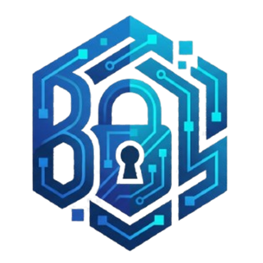
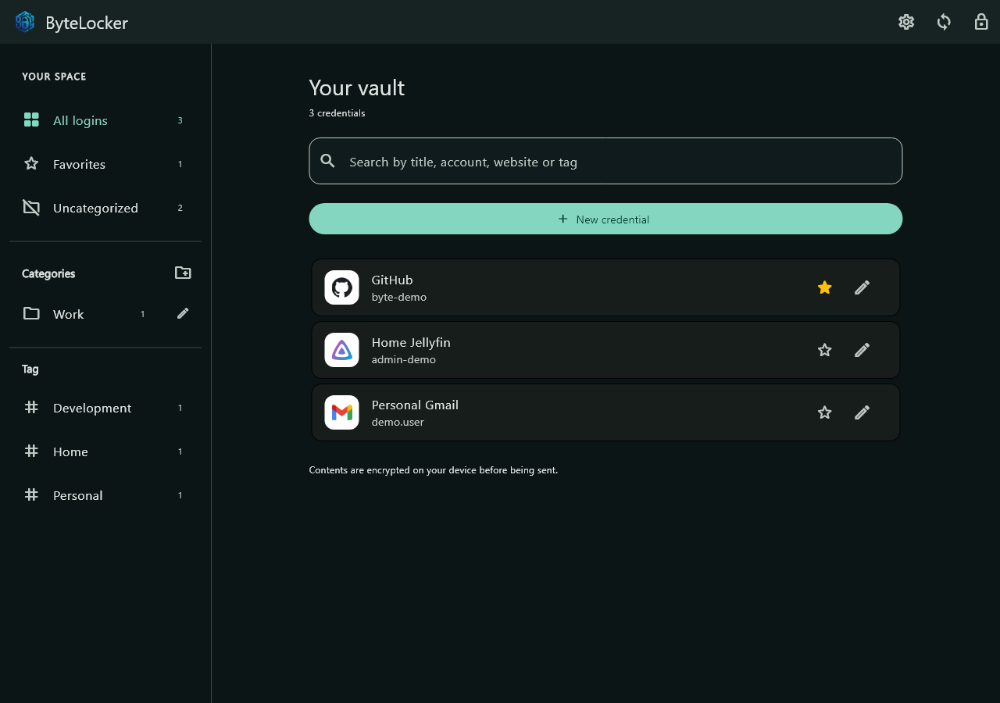
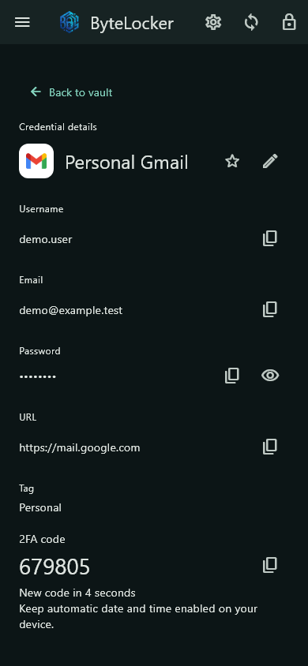
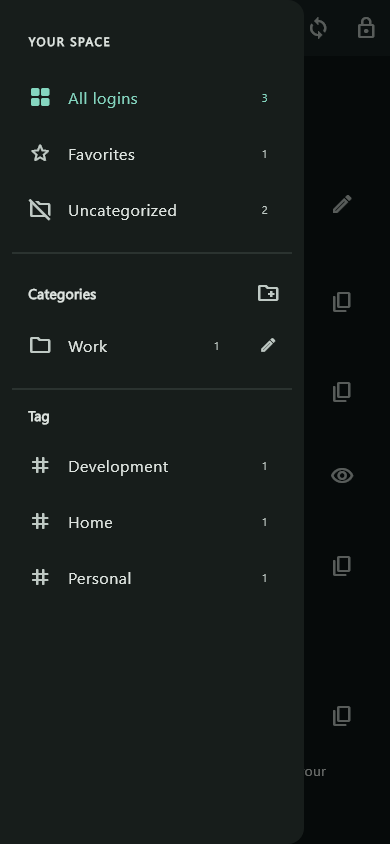

  
  <h1>ByteLocker</h1>
  
<strong>Your passwords. Your server.</strong>

  
An encrypted vault for Android and Windows, hosted on your own CasaOS / Docker server.

  

    <a href="https://github.com/Samu3k/ByteLocker/releases/tag/v0.3.2"><strong>Download</strong></a> ·
    <a href="docs/getting-started.md">Getting started</a> ·
    <a href="docs/self-hosting.md">Self-hosting</a> ·
    <a href="docs/it/README.md">Italiano</a>
  

  

  
Clients 0.3.2 · Server 0.2.3 · Public beta

## A vault that feels at home

- **Choose your language** — Italian, English or your device language, saved in Settings.
- **Stay organized** — categories, favorites, tags and over 3,300 bundled brand icons.
- **Copy in a tap** — usernames, emails, passwords and live 2FA codes.
- **Unlock your way** — Master Password, optional Android biometrics and Android passkey provider support.
- **Host it yourself** — separate vaults for invited users, an admin panel and verified backup tools.

<strong>Take a look at Android</strong>

 

  
  &nbsp;&nbsp;
  

## Get ByteLocker

| Platform | Download | Start here |
| --- | --- | --- |
| Android ARM64 | [APK](https://github.com/Samu3k/ByteLocker/releases/download/v0.3.2/ByteLocker-0.3.2-android-arm64.apk) | Install over the previous version. |
| Windows x64 | [ZIP](https://github.com/Samu3k/ByteLocker/releases/download/v0.3.2/ByteLocker-Windows-0.3.2.zip) | Extract the whole folder and run ByteLocker.exe. |
| CasaOS / Linux x86_64 | [Server package](https://github.com/Samu3k/ByteLocker/releases/download/v0.3.2/bytelocker-casaos-0.2.3.zip) | Follow the [server guide](docs/self-hosting.md). |

**Invited by a friend?** Install a client, enter the HTTPS server address and use your personal invitation. [Quick start →](docs/getting-started.md)

No personal server, account or email credentials are bundled. Downloads are public; joining a server still requires an invitation from its owner.

## Privacy & project status

Vault contents are encrypted on the client with Argon2id and AES-256-GCM. Your Master Password and vault key are not sent to the server. Server secrets and backups stay outside Git.

**This is a development preview, without an independent security audit.** Start with test credentials. Offline sync, password recovery, Windows Hello and a web vault are not available yet; Android passkey compatibility still needs device testing. A stable HTTPS address and production signing remain on the roadmap. The Android beta uses the existing test signature; it is not a Play Store release.

## Explore

[User guide](docs/getting-started.md) · [Self-hosting](docs/self-hosting.md) · [CasaOS commands (Italiano)](docs/it/casaos-commands.md) · [Client builds](client/README.md) · [Contributing](.github/CONTRIBUTING.md) · [Security](.github/SECURITY.md) · [All documentation](docs/README.md)

Screenshots use sample data. Brand logos belong to their respective owners. ByteLocker code is licensed under <a href="LICENSE">GPL-3.0-only</a>, copyright © 2026 Samu3k. Third-party assets and dependencies retain their own licenses and notices in client/third_party and maintenance/third_party.
