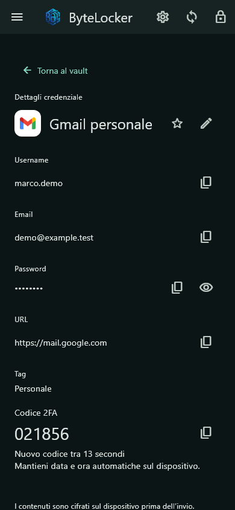
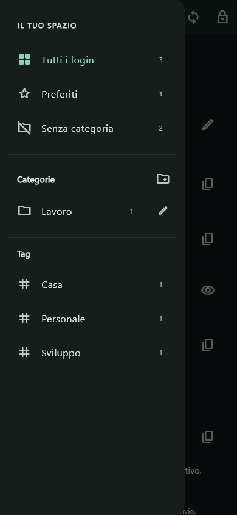

<div align="center">
  
  <h1>ByteLocker</h1>
  <p><strong>Le tue credenziali, sul tuo server.</strong></p>
  <p>Client Android e Windows · Server self-hosted per CasaOS/Docker</p>
  <p>
    <a href="https://github.com/Samu3k/ByteLocker/releases">Pacchetti</a> ·
    <a href="docs/getting-started.md">Inizia qui</a> ·
    <a href="docs/self-hosting.md">Installa il server</a> ·
    <a href="SECURITY.md">Sicurezza</a>
  </p>
</div>

ByteLocker è un password manager in sviluppo che cifra le credenziali sul dispositivo e le conserva sul server scelto dall'utente. Puoi condividere il tuo server con persone invitate, ciascuna con un account e un vault separati, oppure installare un'istanza indipendente.

**Versioni correnti:** client **0.3.1** · server **0.2.3**. Questa repository è inizialmente privata per completare la preparazione alla distribuzione. I pacchetti sono una versione di prova, non una pubblicazione Play Store.


## Dentro ByteLocker

| Funzione | Disponibilità |
| --- | --- |
| Login, password, email, URL, note e tag | Android e Windows |
| Categorie personalizzate e preferiti cifrati | Android e Windows |
| Oltre 3.300 loghi locali, con scelta manuale | Android e Windows |
| Codici TOTP a 6 cifre, con copia al tocco | Android e Windows |
| Dettagli in sola lettura e modifica con la matita | Android e Windows |
| Sblocco con Master Password | Android e Windows |
| Sblocco biometrico e provider passkey | Android compatibile; limiti sotto |
| Tema scuro, chiaro e di sistema | Android |
| Pannello con inviti e gestione utenti | Server |
| Backup coerenti e prova di ripristino | CasaOS/Linux; strumenti inclusi |

<p align="center">
  
  &nbsp;&nbsp;
  
</p>

Le immagini mostrano dati sintetici. I marchi delle credenziali appartengono ai rispettivi titolari e non indicano affiliazione.

## Due modi di usarlo

**Hai ricevuto un invito?** Installa il client, inserisci l'indirizzo HTTPS ricevuto privatamente dal gestore del server e crea il tuo account con l'email invitata. Il codice email serve alla registrazione; ai successivi sblocchi usi la Master Password o la biometria abilitata. [Guida per utenti e amici →](docs/getting-started.md)

**Vuoi il tuo server?** Installa il backend su CasaOS/Docker, configura il mittente email e crea il primo account amministratore. Ogni installazione ha dati, chiavi e utenti indipendenti. [Guida self-hosting →](docs/self-hosting.md)

L'app distribuita non contiene il server personale del proprietario della repository, un account preconfigurato o credenziali Gmail. Al primo avvio il campo server è vuoto. I collegamenti configurati dopo l'installazione restano nel profilo locale del singolo dispositivo e non fanno parte dei pacchetti.

## Scaricare e aggiornare

I pacchetti sono nella sezione [Releases](https://github.com/Samu3k/ByteLocker/releases), separati dai sorgenti:

- `ByteLocker-0.3.1-android-arm64.apk`: Android ARM64, compilazione release privata, circa 24,5 MB.
- `ByteLocker-Windows-0.3.1.zip`: estrarre tutto il contenuto e avviare ByteLocker.exe.
- `bytelocker-casaos-0.2.3.zip`: sorgenti server, configurazioni di esempio e strumenti di manutenzione Linux x86_64.
- `ByteLocker-0.3.1-SHA256.txt`: impronte dei tre pacchetti.

La release iniziale può essere in bozza durante la preparazione. Le release di una repository privata sono accessibili solo agli utenti autorizzati. Per una prova tra amici puoi condividere direttamente il solo APK/ZIP del client e inviare separatamente indirizzo e invito, senza dare accesso al codice o al pannello amministratore.

Per chi usa già ByteLocker: installa l'APK sopra la versione precedente e chiudi Windows prima di sostituire la cartella. **Il blocco degli accessi dovuto alle sessioni richiede anche server 0.2.3.** [Guida di aggiornamento →](docs/update-0.3.1.md)

## Come sono protetti i dati

Master Password e chiave del vault non vengono inviate al server. Il client usa Argon2id, chiavi derivate separate e AES-256-GCM; il server conserva gli involucri cifrati e i metadati necessari agli account. Anche categorie, preferiti, tag, TOTP e materiale passkey sono cifrati nel vault. Il server possiede proprie chiavi operative per registrazione, email e autenticazione: queste devono restare nella singola installazione.

La registrazione richiede un invito e conferma email. Il pannello amministratore usa una chiave dedicata a scadenza e non mostra il contenuto dei vault. I client si bloccano dopo cinque minuti consecutivi in background; chiusura e blocco manuale sono immediati.

Il progetto ha test automatici e vettori crittografici, ma **non ha ancora una revisione crittografica indipendente né una certificazione FIDO**. Per la prova privata usa dati di test; la distribuzione stabile richiede di completare i punti della roadmap e verificare backup/ripristino sul proprio server. [Protocollo](docs/crypto-protocol.md) · [Modello delle minacce](docs/threat-model.md) · [Sicurezza Android](docs/android-security.md)

## Sviluppare

Requisiti del progetto: **Go 1.27.1**, **Flutter 3.47.7 / Dart 3.13.5**. Le dipendenze sono fissate in go.mod/go.sum e pubspec.lock.

```sh
# Dalla radice del repository
node --test scripts/check-publication.test.cjs
node scripts/check-publication.cjs --staged

cd backend
go test -buildvcs=false ./...
cd ../client
flutter pub get
flutter analyze
flutter test --concurrency=1
```

Per compilare Android servono SDK Android e JDK compatibili; per Windows, Visual Studio con sviluppo desktop C++. La firma di produzione Android va configurata separatamente: la chiave privata non deve entrare nella repository. [Build dei client →](client/README.md) · [Contribuire →](CONTRIBUTING.md)

GitHub Actions esegue il controllo di pubblicazione, i test Go e l'analisi/test Flutter con permessi di sola lettura, senza credenziali del server o di firma. Non esegue il deploy sul server personale. Le prove locali della 0.3.1 includono la comunicazione Flutter/Go su SQLite temporaneo; la prima esecuzione remota è visibile in Actions.

## Roadmap verso la distribuzione stabile

- Rinnovo delle sessioni nel client e migliore gestione della registrazione interrotta.
- Cache locale cifrata e sincronizzazione offline.
- Prove passkey su dispositivi/siti reali e maggiore compatibilità Android.
- Windows Hello e provider passkey Windows.
- Firma Android di produzione, installer Windows e procedura di aggiornamento.
- Revisione di sicurezza indipendente e scelta della licenza prima della pubblicazione aperta.

Il vault web, i vault condivisi e il recupero della Master Password non sono disponibili. Il browser espone attualmente solo il pannello amministratore.

## Documentazione

| Guida | Contenuto |
| --- | --- |
| [Primo utilizzo](docs/getting-started.md) | Installazione client, invito e accesso |
| [Self-hosting](docs/self-hosting.md) | Un server indipendente su CasaOS/Docker |
| [Backup e ripristino](docs/backup-casaos.md) | Copie private e verifiche di recupero |
| [Aggiornamento 0.3.1 / 0.2.3](docs/update-0.3.1.md) | Ordine delle operazioni e compatibilità |
| [Pubblicazione e segreti](docs/repository-security.md) | Cosa resta fuori da Git e dai pacchetti |
| [Architettura](docs/architecture.md) | Componenti e confini di fiducia |
| [API](docs/api-contract.md) | Formati e comportamenti del protocollo |

## Licenze e marchi

La licenza del codice ByteLocker sarà scelta prima della pubblicazione aperta; la visibilità privata non concede automaticamente diritti di riutilizzo. Le licenze e le attribuzioni delle dipendenze e dei cataloghi di loghi sono conservate in `client/third_party` e `maintenance/third_party`.
