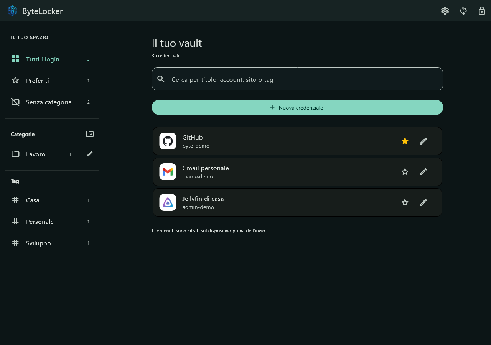
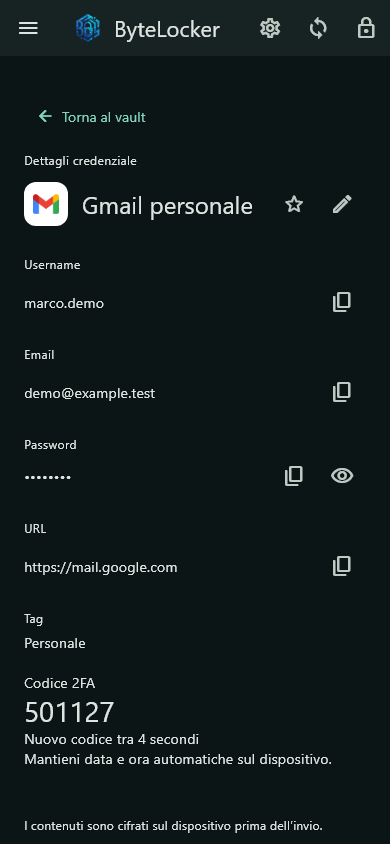

# ByteLocker 0.3.0 — client Windows e Android

## Installazione

Aggiorna **entrambi i client** prima di creare categorie, aggiungere preferiti o scegliere manualmente un logo. Queste funzioni usano lo schema cifrato 4: i vecchi client rifiutano lo snapshot che lo contiene. Le credenziali precedenti restano leggibili nel nuovo client e non sono riscritte automaticamente. Lo schema PM1 di cifratura e le API server non cambiano.

- Android: installa `ByteLocker-0.3.0-android-arm64.apk` sopra l'app esistente, senza disinstallarla. Pacchetto di prova con la stessa firma debug delle versioni precedenti, non destinato al Play Store.
- Windows: chiudi ByteLocker, estrai **tutto** `ByteLocker-Windows-0.3.0.zip` in una nuova cartella e avvia `ByteLocker.exe`. Conserva insieme cartella data e DLL. Il collegamento al server resta nel profilo utente.
- CasaOS: nessun aggiornamento, ricompilazione o riavvio richiesto. L'indirizzo del server resta quello attualmente in uso.

Aggiorna anche gli altri dispositivi collegati allo stesso account. Gli account degli amici hanno vault separati: ciascuno aggiorna tutti i propri client prima di usare le nuove funzioni. Evita di riaprire il vecchio eseguibile dopo l'aggiornamento.

## Nuove funzioni

**Loghi:** catalogo locale di 3.365 marchi; 44 servizi comuni hanno una variante a colori. Il dominio del sito prevale sul titolo e si distinguono servizi come Gmail e Google Drive. Nessuna richiesta di favicon viene inviata a terzi. Nell'editor, Scegli il logo apre la ricerca nel catalogo: puoi correggere una scelta automatica, ritornare ad Automatico oppure usare Solo iniziale. Un logo non costituisce una verifica dell'autenticità del sito. I servizi assenti dal catalogo mostrano l'iniziale.

**Categorie e preferiti:** su finestre ampie, la barra sinistra mostra Tutti i login, Preferiti, Senza categoria, categorie personali e tag. Su Android o finestre strette, apri il menu in alto a sinistra. Il pulsante accanto a Categorie crea una categoria; la matita la rinomina. Nell'editor assegni una categoria al login e puoi crearne una nuova senza uscire dal modulo. La stella nell'elenco o nei dettagli aggiunge/rimuove un preferito. I tag già presenti diventano filtri. Nomi, associazioni e preferiti sono cifrati e sincronizzati con il vault; l'altro dispositivo li vede al caricamento o con Aggiorna.

**Copia:** nei dettagli ci sono pulsanti accanto a username, email, password e URL. Copiare la password non la rende visibile: l'occhio rimane un'azione separata. Gli appunti creati da ByteLocker vengono cancellati dopo circa 60 secondi o al blocco, se contengono ancora il valore dell'app. Windows richiede di escluderli dalla cronologia e dalla sincronizzazione cloud; Android li marca sensibili per nascondere l'anteprima. La pulizia è best effort: Android può impedire l'accesso in background e si riprova al rientro; un processo terminato non può eseguire il timer. Non vengono cancellati contenuti copiati successivamente da altre app.

## Dati e compatibilità

I record schema 4 `category` contengono solo `schema`, `deleted=false`, `type=category` e `title`. Usano lo stesso contenitore cifrato kind 3 delle credenziali e ID casuali. L'elenco delle credenziali e il selettore passkey escludono le categorie.

Una credenziale schema 4 conserva tutti i campi dello schema 3 (con TOTP/passkey nullable) e aggiunge `category_id` (ID canonico o null), `favorite` (booleano) e `logo` (slug o null). `generic` forza l'iniziale. Campo mancante, sconosciuto o di tipo errato blocca l'intero nuovo snapshot. Non si cancellano campi sconosciuti per rendere il record leggibile. Rimozione di una passkey e normali modifiche conservano le informazioni organizzative. Le tombstone restano schema 1.

## Verifica

65 test Flutter superati, un test di interoperabilità Go opzionale escluso dalla suite ordinaria; analisi senza segnalazioni. Le nuove prove coprono sincronizzazione cifrata tra due client, compatibilità precedente, modifiche alla passkey senza perdita di categorie, filtri e creazione categorie su desktop/mobile, copia con password mascherata, selezione manuale del marchio e chiusura del dialogo al blocco. Rendering dell'interfaccia con dati sintetici e caratteri grandi verificato. Compilazioni Windows release e Android debug riuscite; avvio del pacchetto Windows verificato. APK versione 0.3.0, build 6, ARM64: firma verificata e identica alla 0.2.1. ZIP Windows verificato con 3.424 file e percorsi portabili; impronte SHA-256 in `ByteLocker-0.3.0-SHA256.txt`. Il comportamento nativo degli appunti sul telefono richiede una prova reale.
